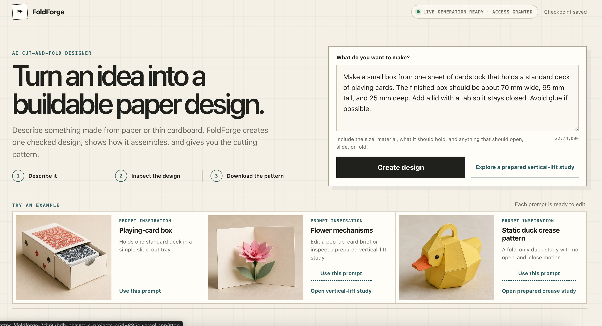
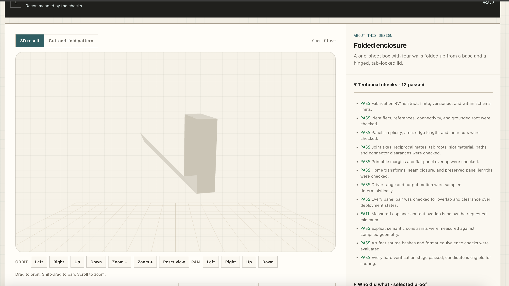
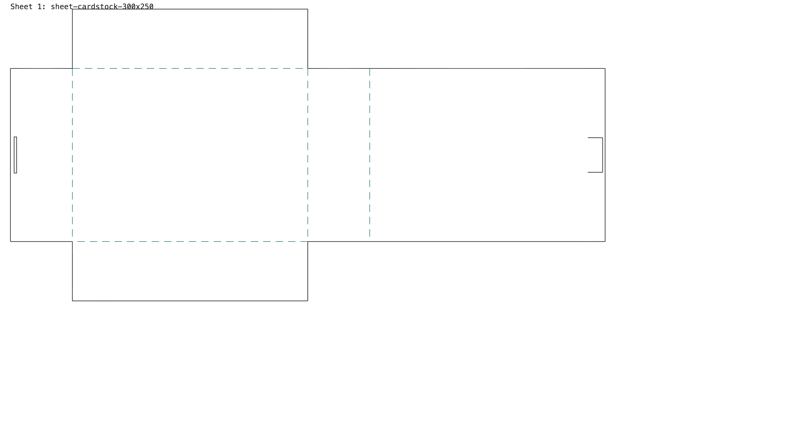

# FoldForge

Describe what you want to fold, such as "a yellow giraffe", "a flamingo", or "fold a paper crane". FoldForge folds it from one square in 3D, step by step, checks that every fold is real, and gives you printable diagrams and the crease pattern to fold it yourself. Many subjects also come as cut-and-glue papercraft, and cards, boxes, and stands have their own engines.



## Origami from a prompt

Every origami result is a square that folds itself in 3D, one step at a time with a written instruction for each, ending in the finished model you can turn. Beside it: step-by-step diagrams, the crease pattern, and downloads (printable instructions, the crease pattern as SVG with red dash-dot mountains and blue dashed valleys, and a FOLD file for Origami Simulator). Code derives the crease pattern from the folds and checks every intermediate state: Maekawa and Kawasaki at every vertex, one consistent flat-folded place for every face, and a layer order in which no paper passes through paper. Nothing that fails is shown.

- **Library models**, designed by hand with beginner-friendly steps: the crane, the swan, a lily, a frog, a dog face, a cat face, a fox face, a heart, a tulip, the flapping bird, a dart paper plane, a paper cup, a fortune teller, a samurai helmet, and the bird, square, waterbomb, fish, and frog bases.
- **The origami box**, an open box from one square with no cuts or glue (a second square 5% larger makes its lid). It ends standing in 3D, so instead of flat-folding rules it is checked by closing every loop of faces: rigid paper holds it with nothing stretched. "A box for my playing cards" or "a gift box 120 x 80 x 40 mm" fold it from a square sized to fit, with the sliding card box or a cut-and-fold box made to exact measurements offered beside it.
- **New designs** for subjects the library does not have. Models come in families, each a checked base shaped by reverse folds whose positions and angles are parameters: long-necked creatures on the kite (giraffe, dinosaur, ostrich, flamingo, llama, camel, duck, chicken, heron), winged birds on the bird base (eagle, dove, parrot, and other birds), fish on the kite (fish, koi, whale, dolphin, shark), the tail turned up as a fin, and four-legged animals seen from above on the frog base (frog, toad, turtle, lizard, crocodile), whose flaps are turned like pages and reverse-folded into legs. Common subjects are tuned by hand; with an AI key, anything else gets parameters chosen for it, labelled as the AI's choice. A design that would not fold is moved to the nearest one that does. Standing animals seen from the side (horse, deer, cow, goat, sheep, donkey, zebra) fold from two squares, as classic two-piece origami does: a body whose four corner points hang down as legs, and a smaller neck-and-head square whose wide end tucks into its front. Each square is checked at every step and has its own animation and downloads, and the page shows them put together; the tuck itself is placed, not checked. A dog keeps the classic dog face.
- **Paper**: a colour word sets the paper ("a blue crane"), otherwise each subject has a natural colour (a pink flamingo, a white swan); "from a 20 cm square" sets the size; the back of the paper stays white.

When a subject also exists as papercraft, the page offers it: "Prefer cut and glue?" builds the printed, glued version beside the origami.

## 3D papercraft

Animals, vehicles, buildings, trees, robots, snowmen, and people come out as low-poly papercraft: coloured A4 pages to print, cut, fold, and glue, with every seam numbered and given a glue tab, printed eyes and windows, a 3D view, and step-by-step instructions. "A blue cat", "a 20 cm penguin", or "a red car" pick the colour and size. Code checks that every printed piece folds back into the 3D model within 0.1 mm and that nothing overlaps or runs off a page. Thirty-two figures are built in (duck, swan, penguin, owl, rat, cat, dog, fox, bear, pig, cow, horse, rabbit, fish, shark, car, bus, truck, house, tower, tree, pine, robot, snowman, person, and more); with an AI key, anything else maps to the closest one, labelled as the AI's choice.

## Pop-up cards and the card box

"A birthday card where a flower pops up" or "a valentine card" gives a real V-fold pop-up: one A4 page with the card, glue guides, and a layered flower (or heart) on its stem, and a 3D view that opens and closes it. Code solves the fold exactly and checks the piece folds flat inside the closed card and never touches a page or itself as it opens. "A box for a deck of playing cards" gives a sleeve printed with card suits and a tray that slides out of it.

Boxes, stands, and anything that opens or slides go to the cut-and-fold engine below.

## Cut-and-fold mechanisms: how they are made

1. **Understand the prompt.** An AI model (or, with no key, a built-in keyword reader) turns your text into a structured fabrication intent: object, size, motion, and stock.
2. **Design it.** The model proposes the parts and how they connect. Deterministic code synthesizes the actual panels, folds, tabs, and slots. If that fails, a parametric template fitted to your dimensions is used, and the result is labelled as a template.
3. **Check it.** Code verifies geometry, sheet packing, folding motion, collisions, and clearances. Nothing that fails is ever shown as valid.
4. **Export it.** Download SVG and DXF patterns (cut = solid, score = dashed), a GLB 3D model, the full JSON record, and FOLD when the design is representable.




## Run it

Requires Node.js 22+ and pnpm.

```bash
pnpm install
```

```bash
pnpm dev
```

Open http://localhost:3000.

**No key needed** for boxes, organizers, desk stands, pop-up cards, bookmarks and tags, and stand-up figures such as ducks, cats, rabbits, hearts, trees, houses, and stars (template mode).

**For any other object**, add a free AI key. Copy `.env.example` to `.env.local` and set:

```
AI_API_KEY=<your Google Gemini key from https://aistudio.google.com/apikey>
```

Groq, OpenRouter, a local Ollama model, or OpenAI also work through `AI_BASE_URL` and `AI_MODEL`; see `.env.example`.

## Develop

```bash
pnpm test
```

```bash
pnpm check
```

`pnpm check` runs lint, types, formatting, tests, export validation, and the production build, which is the same as CI. `pnpm test:e2e` runs the Playwright browser flow.

Code layout and engineering rules are in [AGENTS.md](./AGENTS.md); the fabrication model and verifier limits are in [FABRICATION_SPEC.md](./FABRICATION_SPEC.md).

## Limits

Origami layer orders come from a bounded search, since deciding one is NP-hard in general; every library state has one. Bases collapse in a bar-and-hinge simulator; the frog base, which the simulator cannot settle, is shown turning face by face. The cut-and-fold engine handles flat sheets with panels, cuts, folds, tabs, slots, hinges, and sliders, with up to 24 panels and one manual motion. It does not model smooth curved surfaces, material strength, fatigue, or electronics. It verifies geometry and kinematics, not how well a real card stock holds up.

## License

MIT; see [LICENSE](./LICENSE) and [THIRD_PARTY_NOTICES.md](./THIRD_PARTY_NOTICES.md).
